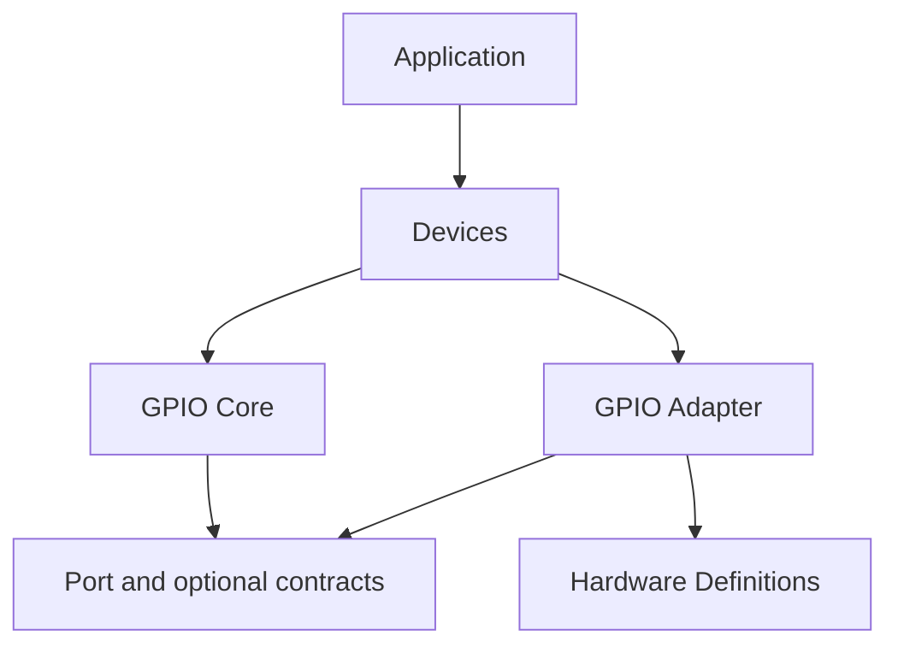

# Use the GPIO Core

Public entry headers are [gpio/gpio.hpp](../include/gpio/gpio.hpp).

## Drive or sample a pin

Bind `GPIO` to a live `Port&`. For an output, check `output(pin)` before calling `high(pin)` or `low(pin)`. Use `input(pin)` for input direction and `read(pin, level)` when you need the physical level. Check the status before using `level`. Direction and drive level are separate requests in this path.

## Bind hardware capabilities

To call `output(pin, initial_level)`, construct with `OutputSetup&`. The Core forwards one operation so the Adapter controls sequencing. For bias, latch or toggle, pass the corresponding pointers in constructor order `pull, latch, toggle`. Each must refer to the same port. Optional operations check pin availability first and return `Unsupported` for a valid pin with a missing capability. The constructor itself cannot verify that independently supplied facets refer to the same resource.

## Composition and lifetime

Application code calls the GPIO Core. It borrows the matching Contract, which an Adapter implements using its Hardware Definitions. Future Devices will create or bind these objects and establish their lifetime. To use the examples today, construct the facade directly with the supplied fake. Keep each borrowed resource alive for its use by the facade and follow the Adapter's access and synchronization requirements.

The arrows below show code dependencies. Devices is the future composition root.

